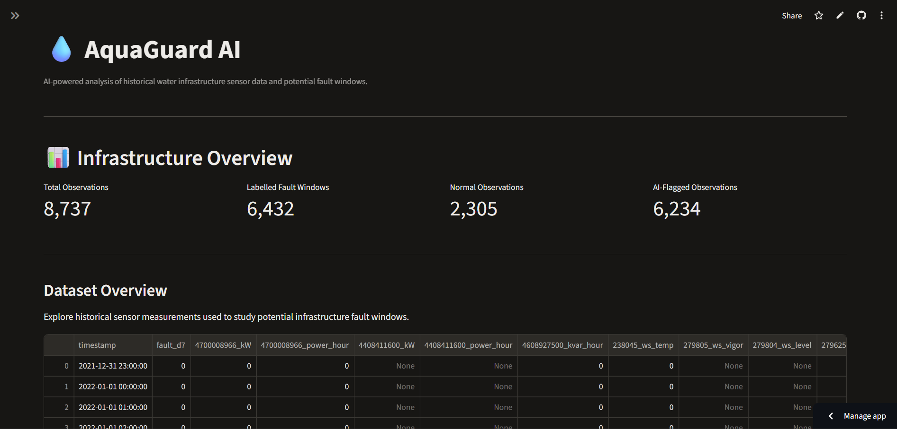

# 💧 AquaGuard AI

[](https://github.com/daysB4summer/AquaGuard-AI/actions/workflows/tests.yml)

### Intelligent Water Infrastructure Fault-Window Monitoring Using Machine Learning
## 🌐 Live Application

🚀 **[Launch AquaGuard AI Dashboard](https://aquaguard-ai-monitor.streamlit.app)**

Explore the interactive dashboard to monitor historical water infrastructure sensor data, examine potential fault windows, and view machine-learning predictions.

## 🖥️ Dashboard Preview



AquaGuard AI is an end-to-end Data Science portfolio project that uses machine learning to analyse historical water infrastructure sensor data and identify potential fault windows.

The project combines data analysis, predictive modelling, model evaluation, and an interactive Streamlit dashboard.

## 🎯 Project Objectives

- Analyse water infrastructure sensor measurements.
- Identify patterns associated with infrastructure fault windows.
- Develop and compare machine learning classification models.
- Investigate missing sensor readings and changes in data distribution.
- Visualise sensor behaviour and model predictions through an interactive dashboard.

## 🛠️ Technologies Used

- **Python** — Data processing and machine learning
- **Pandas and NumPy** — Data cleaning and feature engineering
- **Scikit-learn** — Model development and evaluation
- **Plotly** — Interactive visualisations
- **Streamlit** — Dashboard development
- **Jupyter Notebook** — Exploratory data analysis
- **Joblib** — Model persistence

## 📊 Dataset

The project uses a historical water infrastructure sensor dataset available through [Zenodo](https://zenodo.org/records/15096167).

The dataset contains **8,737 observations**, including measurements from multiple sensors and anomaly scores.

The target variable, `fault_d7`, identifies observations associated with a seven-day fault window.

## 🤖 Machine Learning Models

The project explores Logistic Regression, Random Forest, and Histogram Gradient Boosting.

The two leading development models are:

| Model | Validation Balanced Accuracy |
|---|---|
| Logistic Regression v1 | 69.9% |
| Random Forest v4 | 72.6% |

Random Forest v4 was selected as the current dashboard model using a classification threshold of 0.5.

Model evaluation uses chronological data splitting and a temporal gap to reduce potential overlap between fault-window labels.

**Important limitation:** The earlier Logistic Regression model achieved only 57.0% balanced accuracy on a later test period. Random Forest v4 has not yet undergone an equivalent independent final evaluation. Validation performance should not be interpreted as deployment performance.

### Independent Test Evaluation

Random Forest v4 was evaluated on 1,580 later chronological observations.

| Metric | Test Result |
|---|---|
| Accuracy | 87.1% |
| Balanced Accuracy | 65.9% |
| Precision | 88.1% |
| Recall | 97.7% |
| F1-Score | 92.7% |

**Key Finding:** The model achieved high recall for labelled
fault-window observations but generated a substantial number
of false alarms.

Balanced accuracy decreased from 72.6% during validation
to 65.9% on the independent test period.

These findings highlight the importance of chronological
evaluation, class imbalance, and model generalisation.

## 📈 Interactive Dashboard

The Streamlit dashboard includes four sections:

1. **Infrastructure Overview** — Dataset statistics and fault-window distribution.
2. **Sensor Monitoring** — Interactive sensor graphs and historical fault-window highlighting.
3. **AI Risk Analysis** — Model scores, flagged observations, and downloadable predictions.
4. **Model Performance** — Model comparison and evaluation results.

The dashboard is based on historical data and does not currently connect to live infrastructure sensors.

## 🚀 Running the Project Locally

Clone the repository and open the project folder.

Create and activate a Python virtual environment, then install the required dependencies.

Start the dashboard using:

```bash
streamlit run dashboard/app.py
```

The dashboard will normally be available at `http://localhost:8501`.


## 🔬 Reproducing Model Evaluation

AquaGuard AI includes a standalone Python script for evaluating
the saved Random Forest v4 model on an independent chronological
test dataset.

After installing the project dependencies, run:

```bash
python src/evaluate_model.py
```

The script:
- Loads the processed sensor dataset.
- Recreates the chronological 80/20 train-test split.
- Excludes the first 168 test observations as a temporal gap.
- Loads the saved Random Forest v4 model and preprocessing settings.
- Calculates classification metrics and a confusion matrix.
- Saves the results to `reports/v4_test_results.csv`.

### Independent Test Results

| Metric | Result |
|---|---|
| Test observations | 1,580 |
| Accuracy | 87.1% |
| Balanced accuracy | 65.9% |
| Precision | 88.1% |
| Recall | 97.7% |
| F1-score | 92.7% |

**Limitation:** The model identifies most labelled fault-window
observations but produces a substantial number of false alarms.
It remains a research prototype rather than a production-ready
infrastructure monitoring system.


## ⚠️ Limitations

- The dataset contains fault-window labels, not necessarily exact fault onset times or confirmed individual leaks.
- Missing sensor readings and changing sensor patterns can affect predictions.
- Model scores are not necessarily calibrated probabilities.
- Some dashboard predictions use data seen during model development.
- Additional independent evaluation is required before real-world deployment.

## 🔮 Future Improvements

- Improve generalisation across different time periods.
- Investigate robust handling of missing sensor data.
- Add model explainability and uncertainty analysis.
- Introduce more advanced fault-monitoring visualisations.
- Explore live sensor integration and deployment.

---

**Project Status:** Functional research prototype under development.

**Project:** AquaGuard AI — Data Science and Machine Learning Portfolio